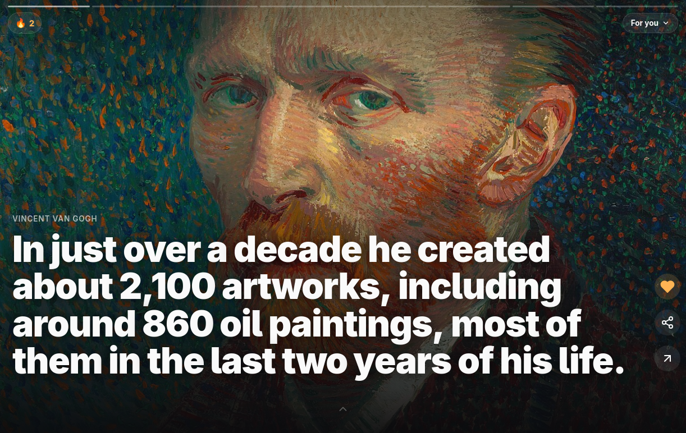
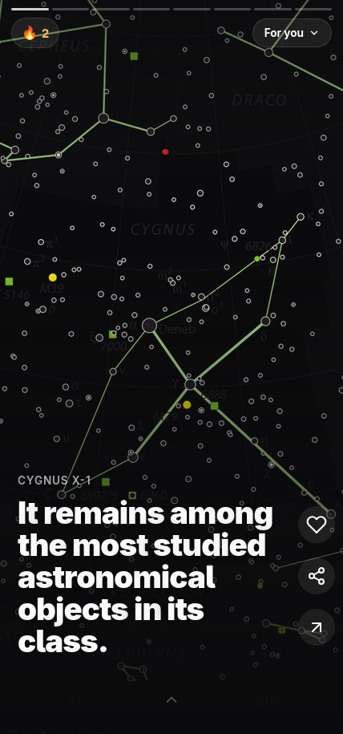
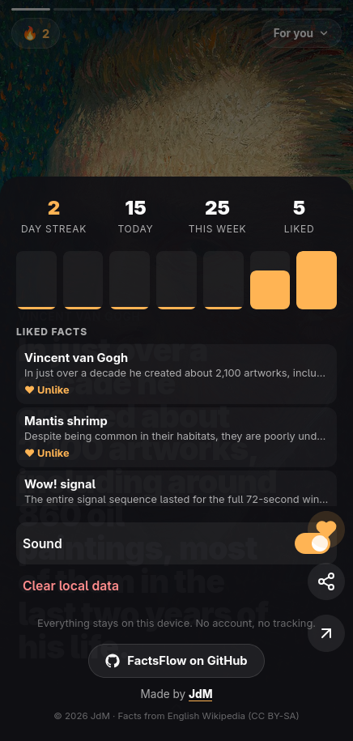
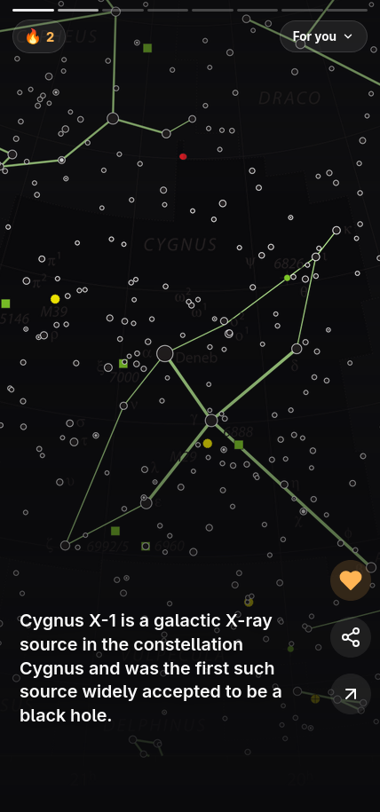

# FactsFlow

> **Doomscrolling, but you learn something.**

<p align="center">
  
</p>

---
[factsflow.jdm.coffee](https://factsflow.jdm.coffee)
---
<p align="center">
  <a href="https://github.com/judemont/FactsFlow/releases/latest/download/app-release.apk"></a>
</p>

---

FactsFlow is a TikTok-style feed where every "video" is a true story pulled from the best of English Wikipedia. Each fact opens with a hook built to stop your thumb, unfolds in a few short screens — context, development, twist — and ends one tap away from the full article.

No account. No ads. No engagement algorithm. Just the strangest and smartest true stories on the internet, one swipe at a time.

| Feed | Stats | Feed |
| --- | --- | --- |
|  |  |  |

## Why it hooks

- **Hook in under 3 seconds** — the most surprising sentence of the article, huge type, no fluff.
- **Curiosity gap** — the hook teases, the reveal lives on the next screen.
- **Story, not wall of text** — 3–6 short screens ordered like a mini-story, ending on a twist. Some facts hide a bonus "Wait, what?" screen.
- **Rare facts** — occasionally a fact drops with a golden frame. A small reason to keep going.
- **Finish the loop** — a segmented progress bar tracks the story; an unfinished one is hard to leave.

## Features

- Full-screen vertical feed: tap for the next slide, swipe (or scroll / arrow keys) for the next fact.
- 4 discovery modes: **For you**, **On this day**, **Topics** (science, history, crime & mysteries, space, nature, arts, tech) and **Near me**.
- Double-tap to like with a heart burst; share generates a clean shareable card.
- Streaks, weekly counter and milestone toasts — all stored on your device.
- The next facts (and their images) are always preloaded: swiping never shows a spinner.
- Reduced motion respected, keyboard accessible, works with no config and no API key.

## Setup

```bash
npm install
npm run dev
```

No config, no API key. The app talks only to the public English Wikipedia APIs (`/w/api.php` and `/api/rest_v1`). `npm run build` produces a static bundle in `dist/`, `npm run preview` serves it, `npm run check` runs svelte-check.

## Architecture

```
src/
  lib/
    wiki.ts      Wikipedia client (extracts, featured feed, on-this-day,
                 geosearch) with in-memory + localStorage caching (TTL),
                 retry with backoff, and stale-cache fallback on failure.
                 Articles without a lead image get one via an imageinfo
                 lookup; facts without any usable image are skipped.
    fact.ts      The fact pipeline: cleans the extract (headings, references,
                 parentheticals, bibliography junk), scores every sentence
                 for surprise (years, numbers, superlatives, striking words,
                 curiosity markers; definition sentences and technical junk
                 are penalized), picks the hook, and — when it makes the
                 hook stronger — truncates it at a clause boundary to create
                 a curiosity gap (the removed clause becomes the reveal on
                 the next screen). The rest is chunked into 3-6 story
                 screens ending on the highest-scoring remaining "twist"
                 sentence; some facts get a bonus "Wait, what?" fact.
    pool.ts      Topic seed lists (7 topics) and a hand-curated pool of
                 verified facts used as an offline/API-failure fallback.
    feed.ts      Feed engine: per-mode candidate suppliers, quality
                 filtering, seen-dedup, and coalesced queue top-ups so the
                 current fact plus the next 3 are always ready (images
                 preloaded); rapid scrolling cannot stack parallel fetches.
    storage.ts   localStorage only: likes, history, seen ids, daily streak,
                 weekly counter, settings. Nothing leaves the device.
                 Legacy `pepite.*` and `factflow.*` keys are migrated automatically.
    share.ts     Canvas-rendered shareable card (title + hook + image),
                 shared via the Web Share API with clipboard fallback.
    sound.ts     Optional Web Audio tick/pop + haptics. Off by default.
    utils.ts     fetchJSON with TTL caching, in-flight request dedup,
                 and a global rate limiter (min gap between Wikipedia
                 calls, extra backoff on HTTP 429).
  components/
    Feed.svelte  Swipe physics (touch drag with velocity + resistance,
                 wheel, keyboard), double-tap like with heart burst,
                 progress bar, preloading.
    FactCard.svelte  Hook / story / payoff screens, Ken Burns background,
                 rare-frame on occasional facts. Tap advances slides,
                 swipe scrolls to the next or previous fact.
    ModeSwitcher / StatsSheet / ProgressBar / Toasts / Skeleton
```

## Discovery modes

- **For you** — the main feed: today's featured and most-read articles mixed with topic seeds, weighted by the topics you like the most.
- **On this day** — Wikipedia's "selected" events for today's date.
- **Topics** — science, history, crime & mysteries, space, nature, arts, tech.
- **Near me** — geosearch around your location (permission asked only when the mode opens). When a mode runs dry, the feed falls back to For you instead of ending.

## Privacy

No account, no analytics, no trackers. Likes, history, streak and settings live in `localStorage`; the only network traffic is read-only Wikipedia API calls. Likes are local only: they appear in the stats sheet history, count in your stats, and quietly bias which topics the feed serves next. Tapping a liked fact reopens it inside FactsFlow (`?fact=<id>`; old `?gem=<id>` links still work) — the Wikipedia link stays one tap away inside the fact.
